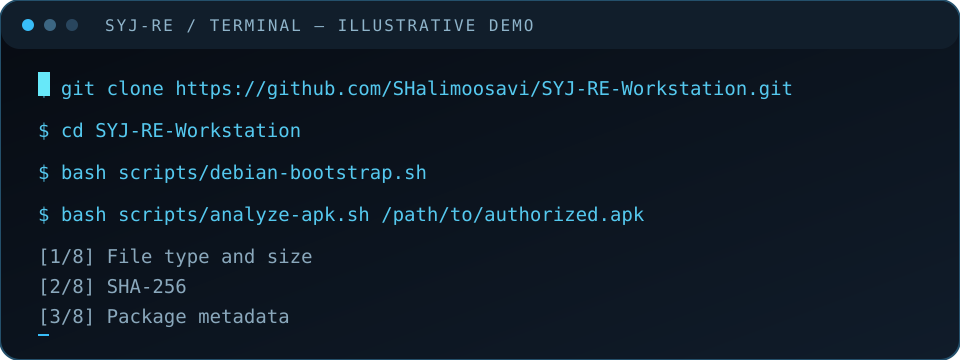
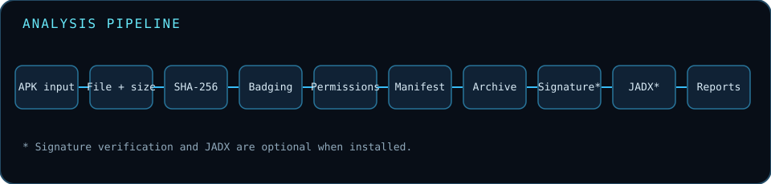
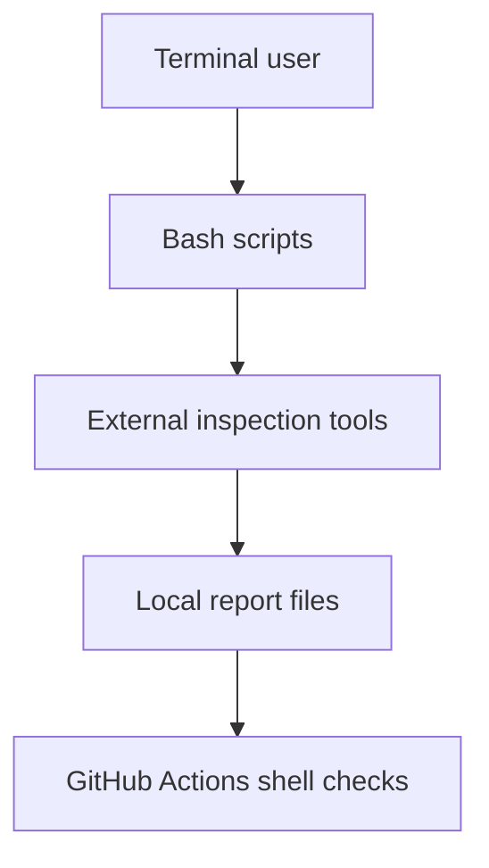
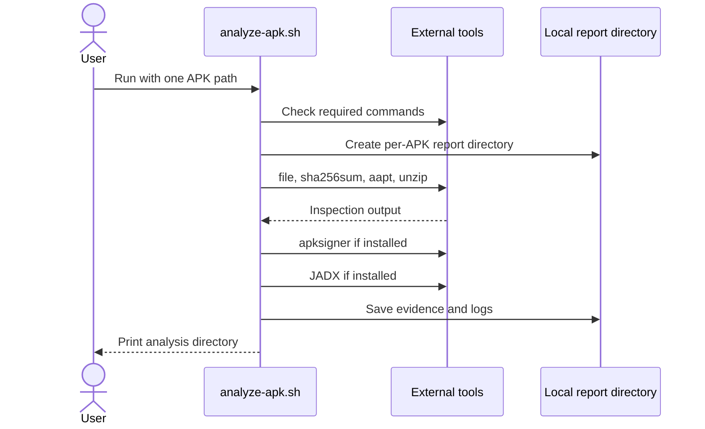

<p align="center">
  
</p>

# SYJ-RE-Workstation

Open-source reverse engineering and APK analysis for Android security inspection and static analysis on Debian, Linux and Android through Termux. The workstation uses Bash scripts to collect APK metadata, permissions, manifest structure, archive inventory, signatures and optional decompilation evidence.

## What is SYJ-RE-Workstation?

SYJ-RE-Workstation is a Bash-based, open-source workstation scaffold for static inspection of Android APK files. It runs on Linux environments, including Debian PRoot launched from Termux, and records package metadata, permissions, manifest information, archive contents, optional signature verification and optional JADX output in local report directories.

## At a glance

| Fact | Value |
|---|---|
| Name | SYJ-RE-Workstation |
| Type | Open-source Android APK static-analysis workstation |
| Primary language | Bash |
| License | MIT |
| Platforms / environments | Debian and compatible Linux; Debian PRoot on Android through Termux |
| Status | Early prototype; validation is ongoing |
| Requirements | Bash, file, sha256sum, unzip, AAPT; optional apksigner and JADX |
| Owner | Syed Ali Hasan Moosavi |
| Organization | SAYANJALI NEXUS PRIVATE LIMITED |
| Repository URL | https://github.com/SHalimoosavi/SYJ-RE-Workstation |

<p align="center">
  <a href="LICENSE"></a>
  <a href="https://github.com/SHalimoosavi/SYJ-RE-Workstation/actions/workflows/shellcheck.yml"></a>
  <a href="https://github.com/SHalimoosavi/SYJ-RE-Workstation/commits/main"></a>
</p>

<p align="center"></p>

## How to analyze an APK in 5 steps

The command blocks in this README are usage examples, not claims that every command was executed in every environment. Replace example APK paths with the actual path to a sample you are authorized to assess. The Debian 12/13 and Ubuntu 22.04/24.04 package installation tests remain unverified; see the [tool compatibility matrix](docs/android-tool-installation.md).

1. **Install Termux packages and clone the project:**
   ```bash
   pkg update
   pkg install -y git proot-distro
   git clone https://github.com/SHalimoosavi/SYJ-RE-Workstation.git
   cd SYJ-RE-Workstation
   ```
2. **Install Debian PRoot** (first-time setup):
   ```bash
   proot-distro install debian
   ```
3. **Enter Debian with the repository and APK directory mounted.** In Termux, first create an input folder and put your authorized APK there:
   ```bash
   mkdir -p "$HOME/rea-input"
   proot-distro login debian --bind "$HOME/SYJ-RE-Workstation:/mnt/syj-re" --bind "$HOME/rea-input:/mnt/apk-input"
   ```
4. **Install base packages and Android tools** using the instructions in [Install Android analysis tools](docs/android-tool-installation.md). The Debian bootstrap installs base utilities only; AAPT is required for analysis.
5. **Run the analyzer inside Debian:**
   ```bash
   bash /mnt/syj-re/scripts/analyze-apk.sh /mnt/apk-input/your-authorized-app.apk
   ```

Reports are written under `$HOME/SYJ-RE-Workstation/reports/<apk-name>/` inside the Debian environment by default.

## Install on Debian

Clone the repository and install its base utilities:

```bash
git clone https://github.com/SHalimoosavi/SYJ-RE-Workstation.git
cd SYJ-RE-Workstation
sudo bash scripts/debian-bootstrap.sh
```

The bootstrap script installs base command-line tools. It does not install AAPT, apksigner, APKTool or JADX. AAPT is required; apksigner and JADX are optional for the current analyzer. APKTool is not called by the current scripts.

See [Android tool installation and release compatibility](docs/android-tool-installation.md) for package names, repository package versions and exact installation commands. Package availability is not the same as a successful installation test: the Debian 12, Debian 13, Ubuntu 22.04 and Ubuntu 24.04 install tests remain unverified in this environment.

## Install on Android with Termux

Install Git and PRoot-Distro, then clone the repository:

```bash
pkg update
pkg install -y git proot-distro
git clone https://github.com/SHalimoosavi/SYJ-RE-Workstation.git
cd SYJ-RE-Workstation
```

The optional helper performs the Termux package setup:

```bash
bash scripts/termux-bootstrap.sh
```

Create a directory for APK inputs and mount both the repository and input directory into Debian:

```bash
mkdir -p "$HOME/rea-input"
proot-distro install debian
proot-distro login debian --bind "$HOME/SYJ-RE-Workstation:/mnt/syj-re" --bind "$HOME/rea-input:/mnt/apk-input"
```

Inside Debian, run:

```bash
bash /mnt/syj-re/scripts/debian-bootstrap.sh
```

Grant Termux shared-storage access with `termux-setup-storage` only if your APKs are stored in Android shared storage. Bind the actual Termux-side input directory; creating a similarly named directory inside Debian does not expose Android storage.

## Analyze an APK

Use only APKs you own or have explicit permission to assess. The analyzer accepts one positional APK path and has no additional command-line flags:

```bash
bash scripts/analyze-apk.sh /path/to/authorized-application.apk
```

Required executables: `file`, `sha256sum`, `unzip` and `aapt`. The script collects:

1. File identification and size.
2. SHA-256 digest.
3. Package metadata from `aapt dump badging`.
4. Permission output from `aapt dump permissions`.
5. Manifest tree from `aapt dump xmltree`.
6. ZIP archive inventory and matching DEX/native-library paths.
7. Signature verification using `apksigner`, if installed.
8. JADX decompilation using `jadx --no-res`, if installed.

Set `SYJ_RE_HOME` to select a different workstation root:

```bash
SYJ_RE_HOME="$HOME/re-lab" bash scripts/analyze-apk.sh /path/to/authorized-application.apk
```

## Compare analysis reports

Pass two existing report directories to the comparison helper:

```bash
bash scripts/compare-reports.sh /path/to/report-A /path/to/report-B
```

It compares `badging.txt`, `permissions.txt`, `dex-and-native-libraries.txt` and `signature.txt`. Missing files are reported. The script continues through all four comparisons and suppresses `diff`'s non-zero status; therefore, a zero exit code does not mean the reports are identical.

## Read the evidence

Start with `REPORT-INFO.txt`, `file.txt` and `sha256.txt`. Review `badging.txt`, `permissions.txt` and `manifest-tree.txt` for package and manifest evidence. Use `archive-files.txt` and `dex-and-native-libraries.txt` for archive inventory. If available, inspect `signature.txt`, `jadx-status.txt` and `jadx.log`.

A successful run means the scripted collection steps completed; it does not mean the APK is safe. A non-zero JADX exit code is recorded separately and does not invalidate the other collected reports.

## What ships today and what is planned

**Ships today**
- Bash orchestration for APK file identification, SHA-256, AAPT metadata, permissions and manifest output.
- ZIP archive inventory and DEX/native-library path filtering.
- Optional apksigner verification and optional JADX invocation.
- A report comparison helper.
- Termux and Debian bootstrap scripts.
- GitHub Actions shell syntax and ShellCheck workflow.

**Planned, not shipped**
- Dedicated ELF/native binary analysis workflows.
- Automated APKTool integration.
- Dynamic instrumentation or runtime analysis.
- Additional report formats and integrated analysis modules.
- Broader cross-distribution and device validation.

## Known limitations

- The repository is an early prototype. Cross-device and cross-distribution validation is incomplete.
- AAPT is required and is not installed by the Debian bootstrap script.
- apksigner and JADX are optional. APKTool is not called by current scripts.
- JADX may not decompile all generated, inline, Kotlin coroutine or framework code cleanly. Review its log and corroborate observations.
- Signature verification errors are recorded as warnings and analysis continues.
- Static inspection cannot establish that an APK is safe, malicious or exploitable.
- Debian PRoot is a Linux userspace, not a virtual machine. It does not change the Android CPU architecture or provide a separate kernel, hardware virtualization, cgroups or every Android device interface.
- CI checks shell syntax and linting; it does not run APK integration tests or validate every platform.
- The requested clean-container install tests for Debian 12/13 and Ubuntu 22.04/24.04 could not be completed in the current environment.

## Frequently asked questions

### What is SYJ-RE-Workstation and who is it for?

SYJ-RE-Workstation is a Bash-based toolkit scaffold for collecting static evidence from Android APK files. It is intended for developers, security learners and analysts who need a repeatable local workflow for APK metadata, permissions, manifest structure, archive contents and optional decompilation. It is early-stage software, not a complete reverse-engineering suite.

### How do I analyze an APK on Android with Termux?

Install Git and PRoot-Distro in Termux, clone this repository, install Debian with `proot-distro install debian`, then enter Debian with the repository and APK input directory mounted. Install AAPT and the base dependencies inside Debian, then run `scripts/analyze-apk.sh` against the mounted APK path. The five-step workflow above gives the full command sequence.

### Does it need root access?

No Android root access is required for the documented Termux plus Debian PRoot workflow. PRoot runs a Linux userspace without rooting the Android device. The Debian bootstrap script itself must run as root inside Debian, which is normally the default PRoot-Distro login user; this is not Android device root.

### Can I run it on Debian or Ubuntu?

The scripts target Debian-compatible Linux environments and use Bash plus standard command-line utilities. Package names and versions vary by distribution release and architecture. The documentation lists package-index availability for Debian 12/13 and Ubuntu 22.04/24.04, but clean install tests for those four releases have not been completed here. Treat the matrix as reference, not a compatibility guarantee.

### Which tools do I need to install?

The analyzer requires Bash, `file`, `sha256sum`, `unzip` and AAPT. `apksigner` enables optional signature verification; JADX enables optional DEX-to-Java decompilation. APKTool is useful for manual resource and smali work but is not called by the current scripts. The Debian bootstrap installs base utilities only.

### Does it detect malware or prove an app is safe?

No. The workstation performs static evidence collection; it does not provide a malware verdict, complete vulnerability scan, exploitability assessment or proof of safety. Permissions, manifest values, signatures and decompiler output need interpretation and independent corroboration. A clean-looking report is not a security certification and should not be presented as one.

### Is it legal to analyze an APK?

Only analyze applications you own or have permission to assess, and respect applicable law, contracts, platform terms and intellectual property rights. Legal requirements differ by jurisdiction and circumstance. This README is operational guidance, not legal advice; obtain qualified advice if authorization or permitted scope is unclear.

### Where are reports saved?

By default, reports are created under `$HOME/SYJ-RE-Workstation/reports/<apk-name>/`. Set the `SYJ_RE_HOME` environment variable to change the workstation root; the report directory is then created beneath that location. In Debian PRoot, the home directory is Debian's home, not automatically the Termux home directory.

### How do I compare two reports?

Run `bash scripts/compare-reports.sh /path/to/report-A /path/to/report-B`. The helper compares package metadata, permissions, DEX/native-library inventories and signature output. It prints missing-file notices and continues across the report types. Because it suppresses `diff` exit codes, inspect the displayed output rather than relying on the command's final status.

### What does it not do yet?

It does not perform dynamic instrumentation, runtime behavior monitoring, automated malware classification, vulnerability confirmation, ELF workflow orchestration, APKTool integration or a complete binary analysis pipeline. Several tools are documented as optional/manual integrations. The current scope is intentionally limited to static APK evidence collection and report comparison.

### How can I contribute?

Read [CONTRIBUTING.md](CONTRIBUTING.md), open an issue describing the change, create a focused branch and submit a pull request. Run `bash -n scripts/*.sh` and ShellCheck, test with a disposable APK you are authorized to use, and include sanitized tool versions and logs for compatibility reports. Never contribute APKs, credentials, generated reports or proprietary source.

## Architecture and documentation

The workstation is a Bash orchestration layer around external inspection utilities. Reports remain local and are excluded from source control by default.

<p align="center"></p>

### Architecture flow



### APK inspection sequence



**Related documentation**
- [Android tool installation and compatibility](docs/android-tool-installation.md)
- [Architecture and environment boundaries](docs/architecture.md)
- [Security and privacy guidance](docs/security-and-privacy.md)
- [Troubleshooting](docs/troubleshooting.md)
- [Contribution guide](CONTRIBUTING.md)
- [Security policy](SECURITY.md)

## About the developer

**Syed Ali Hasan Moosavi** is the Founder & Managing Director of **SAYANJALI NEXUS PRIVATE LIMITED**. His public repositories cover AI products, blockchain infrastructure, enterprise SaaS, security and OSINT tooling, and open-source developer utilities.

### More projects by the same developer

Status is based on each repository's latest commit date available during this documentation update and the project's own README wording. Dates are UTC.

| Public repository | Description | Status | Latest commit |
|---|---|---|---|
| [SAYANJALI OSINT](https://github.com/SHalimoosavi/sayanjali-osint) | Python OSINT and threat-intelligence tooling | Prototype | 2026-06-18 |
| [SYJ Scholar AI](https://github.com/SHalimoosavi/SYJ-SCHOLAR-AI) | Offline AI study companion for Android and Termux | Prototype | 2026-06-18 |
| [SYJ LLM](https://github.com/SHalimoosavi/SYJ-LLM) | C++17 local LLM runtime, GGUF registry and localhost API foundation | Prototype | 2026-09-20 |
| [SAYANJALI BLOCKCHAIN](https://github.com/SHalimoosavi/SAYANJALI-BLOCKCHAIN) | Layer-1 blockchain implementation and protocol research | Early | 2026-10-02 |
| [SYJ LaunchPad](https://github.com/SHalimoosavi/SYJ-LaunchPad) | Self-hosted Web3 token launchpad foundation | Early | 2026-09-27 |
| [SYJ Deploy](https://github.com/SHalimoosavi/SYJ-DEPLOY) | Self-hosted Git-based deployment dashboard; README identifies a v1.1.0-beta hardening release | Active | 2026-10-17 |

Active is used only for SYJ Deploy because its 2026-10-17 commit was within roughly 30 days of this review and its README describes a v1.1.0-beta hardening release. The other five are marked Prototype or Early because their latest commits were older; these labels describe repository activity/maturity for this table, not product quality.

### Contact and project support

- Developer: [GitHub profile](https://github.com/SHalimoosavi)
- Portfolio: [shalimoosavi.github.io/moosavi](https://shalimoosavi.github.io/moosavi/)
- Project contact: [shalimoosavi@gmail.com](mailto:shalimoosavi@gmail.com)
- Report bugs and request features through [GitHub Issues](https://github.com/SHalimoosavi/SYJ-RE-Workstation/issues).

GitHub Discussions are not listed because their availability for this repository has not been confirmed.

## Roadmap

The project is early-stage. Delivery status below describes current repository scope, not a promise that planned work is implemented.

| Phase | Scope | Status |
|---|---|---|
| Phase 0 — Foundation | Bash analyzer, SHA-256, AAPT metadata/permissions/manifest, ZIP inventory, optional signature/JADX hooks, local reports and report comparison | Implemented in repository; compatibility validation pending |
| Phase 1 — Verified static foundation | Four-release CI matrix, regression tests, installation documentation, contributor workflow and reproducible example report | In progress; do not call verified until all matrix jobs pass |
| Phase 2 — Static analysis expansion | APKTool integration, ELF/native inspection, dedicated DEX analysis and richer report formats | Planned; not shipped |
| Phase 3 — Runtime analysis | Separate, controlled dynamic instrumentation and runtime-analysis project/workstream | Planned; not shipped and not part of current static analyzer |

See [GitHub milestones](https://github.com/SHalimoosavi/SYJ-RE-Workstation/milestones) for tracked work. A milestone is a planning container; it does not imply completion.

## License

SYJ-RE-Workstation is released under the [MIT License](LICENSE).

---

<p align="center"><br><strong>Reverse Engineering. Security Analysis. Open Source.</strong></p>
