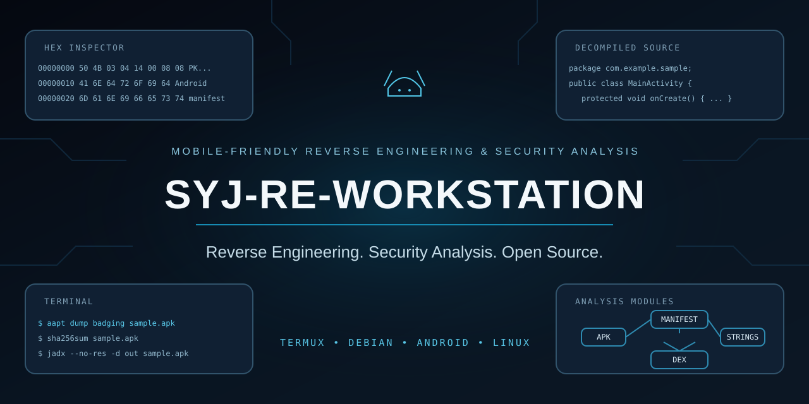
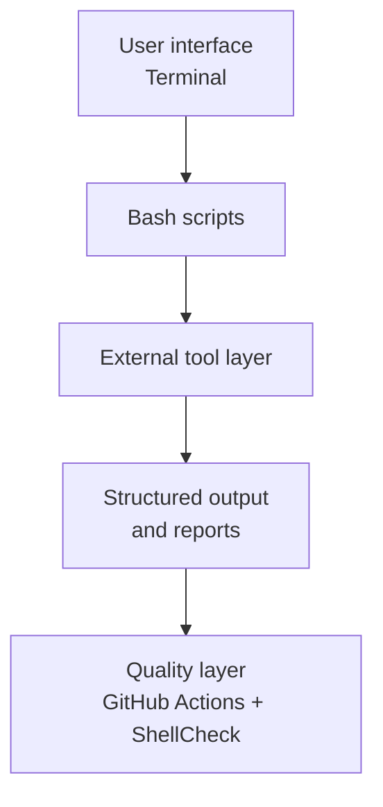
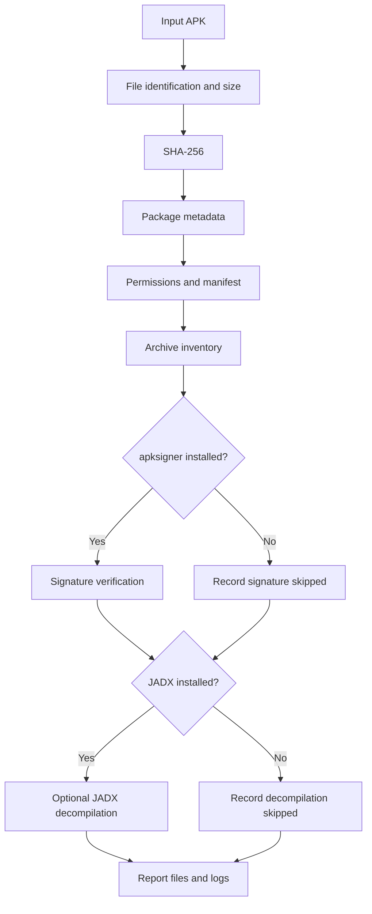
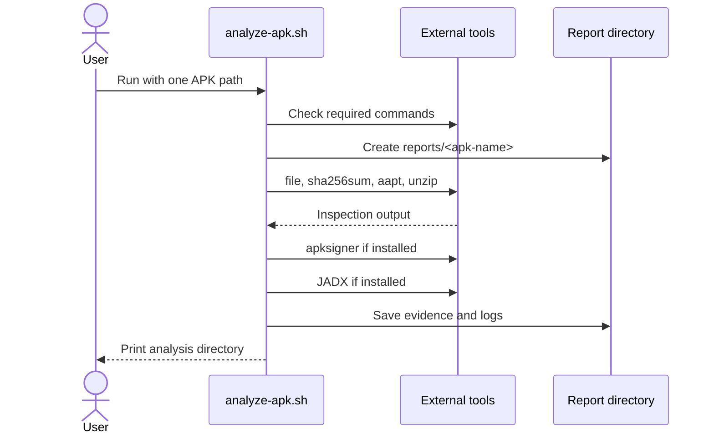
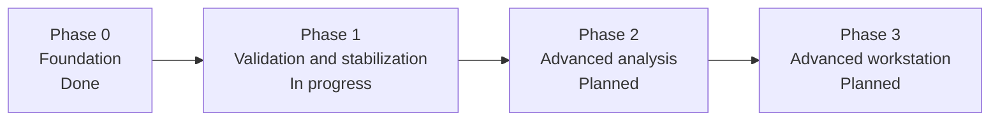

<p align="center">
  <picture>
    <source media="(prefers-color-scheme: dark)" srcset="docs/assets/syj-re-workstation-social-preview.svg">
    <source media="(prefers-color-scheme: light)" srcset="docs/assets/syj-re-workstation-social-preview.svg">
    
  </picture>
</p>

<h1 align="center">SYJ-RE-Workstation</h1>
<p align="center">An open-source reverse engineering and security analysis toolkit for Linux-based environments, including Debian PRoot and Android via Termux.</p>
<p align="center"><strong>Reverse Engineering. Security Analysis. Open Source.</strong></p>
<p align="center">
  <a href="LICENSE"></a>
  <a href="https://github.com/SHalimoosavi/SYJ-RE-Workstation/actions/workflows/shellcheck.yml"></a>
  <a href="https://github.com/SHalimoosavi/SYJ-RE-Workstation/commits/main"></a>
  <a href="https://github.com/SHalimoosavi/SYJ-RE-Workstation"></a>
</p>

<p align="center"></p>

SYJ-RE-Workstation brings APK analysis, reverse engineering, static analysis, Android security inspection and binary investigation workflows together for Debian, Termux and compatible Linux environments. The current implementation focuses on APK metadata, permissions, manifest structure, archive inventory, signatures and optional decompilation. Broader binary-analysis workflows remain a development objective.

> **Status:** Initial public release scaffold, under active development and validation. The scripts provide static inspection only; they do not perform dynamic instrumentation or provide a vulnerability verdict.

## Quick start

Use a Linux environment with Bash, `file`, `sha256sum`, `unzip` and `aapt` available. The APK must be one you own or are authorized to assess.

```bash
git clone https://github.com/SHalimoosavi/SYJ-RE-Workstation.git
cd SYJ-RE-Workstation
bash scripts/analyze-apk.sh /absolute/path/to/authorized.apk
```

Default reports are written to `$HOME/SYJ-RE-Workstation/reports/<apk-name>/`. See [Installation](#installation) for setup and [Usage](#usage) for report details.

## Contents

- [Installation](#installation) · [Usage](#usage) · [How it works](#how-it-works)
- [Features and tool integrations](#features-and-tool-integrations) · [Repository structure](#repository-structure)
- [Analysis output](#analysis-output) · [Roadmap](#roadmap)
- [Known limitations](#known-limitations-and-compatibility)
- [Security](#security-and-responsible-use) · [Contributing](#contributing) · [License](#license-and-project-information)

## Installation

### A. Android with Termux

**Prerequisites:** Android device with Termux from a trusted distribution source; network access. Shared-storage permission is needed only when reading APKs from Android shared storage.

Run the same package setup as the Termux helper:

```bash
pkg update
pkg install -y git proot-distro
```

Or run the helper from the repository:

```bash
bash scripts/termux-bootstrap.sh
```

The helper updates package metadata, installs `git` and `proot-distro`, and prints the next step. It does not install Debian or Android analysis tools.

```bash
proot-distro install debian
proot-distro list
```

Expected: `debian` appears in the installed distributions list. If APKs are in shared storage, grant access with `termux-setup-storage`.

### B. Debian PRoot on Android

**Prerequisites:** Termux, Debian installed with PRoot-Distro, repository available to Debian, and an APK input directory.

From Termux, mount the checkout into Debian (adjust the source path if your checkout is elsewhere):

```bash
proot-distro login debian --bind "$HOME/SYJ-RE-Workstation:/mnt/syj-re"
```

Inside Debian, install the base packages:

```bash
bash /mnt/syj-re/scripts/debian-bootstrap.sh
command -v file sha256sum unzip
```

Expected: the verification command prints executable paths. APK analysis also requires `aapt`; install Android SDK Build Tools from a trusted source and verify the release before use.

<details><summary>Debian cannot see the APK input directory</summary>

A directory created inside Debian is not automatically Android shared storage. From Termux, bind the real Termux-side directory:

```bash
mkdir -p "$HOME/rea-input"
proot-distro login debian --bind "$HOME/SYJ-RE-Workstation:/mnt/syj-re" --bind "$HOME/rea-input:/mnt/apk-input"
```

Put authorized APKs in Termux's `~/rea-input`; they appear inside Debian at `/mnt/apk-input`.

</details>

<details><summary>PRoot reports architecture or permission limitations</summary>

PRoot is a Linux userspace, not a virtual machine. It does not change the Android CPU architecture, provide a separate kernel or hardware virtualization, or expose every Android device interface. Some tools may have reduced functionality.

</details>

### C. Debian or Ubuntu Linux

**Prerequisites:** Debian or Ubuntu with `apt-get`, root access or `sudo`, Bash and network access.

```bash
git clone https://github.com/SHalimoosavi/SYJ-RE-Workstation.git
cd SYJ-RE-Workstation
sudo bash scripts/debian-bootstrap.sh
```

The helper installs its base package list and checks whether `aapt`, `apksigner`, `apktool` and `jadx` are already available. It does not install those Android-specific tools.

Verify the base commands and the required AAPT dependency:

```bash
command -v bash file sha256sum unzip
command -v aapt
```

Expected: each command prints an executable path. If `aapt` is missing, the analyzer cannot run. Install Android SDK Build Tools and JADX from trusted upstream sources and ensure executables are on `PATH`.

<details><summary>Bootstrap says to run as root</summary>

Run `sudo bash scripts/debian-bootstrap.sh` or use a root shell. The helper checks that its effective user ID is zero.

</details>

## Usage

### Analyze an APK

**Authorized use only:** analyze applications you own or have explicit permission to assess. Do not install or execute unknown APKs as part of this static workflow. Keep proprietary samples and generated evidence private.

The analyzer accepts exactly one positional argument and has no additional flags:

```bash
bash scripts/analyze-apk.sh /path/to/authorized-application.apk
```

Required executables: `file`, `sha256sum`, `unzip` and `aapt`. The script then:

1. Records file type and size.
2. Calculates SHA-256.
3. Saves package metadata using `aapt dump badging`.
4. Saves permissions using `aapt dump permissions`.
5. Saves the manifest tree using `aapt dump xmltree`.
6. Lists archive entries and filters DEX and native-library paths.
7. Runs `apksigner verify --verbose --print-certs` if `apksigner` is installed.
8. Runs `jadx --no-res -d` if JADX is installed, preserving its log and exit code.

Default output:

```text
$HOME/SYJ-RE-Workstation/reports/<apk-name>/
```

Set `SYJ_RE_HOME` to choose another workstation root:

```bash
SYJ_RE_HOME="$HOME/re-lab" bash scripts/analyze-apk.sh /path/to/authorized-application.apk
```

### Compare reports

The comparison helper accepts exactly two existing report directories:

```bash
bash scripts/compare-reports.sh /path/to/report-A /path/to/report-B
```

It runs unified diffs for `badging.txt`, `permissions.txt`, `dex-and-native-libraries.txt` and `signature.txt`. Missing files are reported. Differences are not classified as vulnerabilities. The script continues through all four comparisons and suppresses diff's non-zero status, so a zero exit status does not mean the reports are identical.

### Read the evidence

Start with `REPORT-INFO.txt`, `file.txt` and `sha256.txt). Review `badging.txt`, `permissions.txt` and `manifest-tree.txt) for package and manifest evidence. Use `archive-files.txt` and `dex-and-native-libraries.txt` for archive inventory. If available, inspect `signature.txt`, `jadx-status.txt` and `jadx.log`.

A successful run means the scripted collection steps completed; it does not mean the APK is safe. A non-zero JADX exit code is recorded separately and does not invalidate other collected reports.

## How it works

The workstation is a Bash orchestration layer around external inspection utilities. Analysis evidence stays in a local reports directory rather than being committed to the public repository.

<p align="center"></p>

*The pipeline follows the current analyzer; signature verification and JADX are conditional on their executables being installed.*

### Architecture



*The terminal invokes scripts, which call external tools and write local evidence; CI checks shell syntax and linting.*

### APK analysis workflow



*This flow mirrors `scripts/analyze-apk.sh`; signature and JADX branches are optional.*

### Execution sequence



*The sequence shows the script's actual tool calls and local output destination.*

## Features and tool integrations

| Tool or component | Purpose | Current repository use | Requirement and platform notes |
|---|---|---|---|
| Bash | Workflow orchestration | Ships today | Required |
| `file` | File identification | Required by analyzer | On `PATH` |
| `sha256sum` | SHA-256 digest | Required by analyzer | On `PATH` |
| `unzip` | APK archive inventory | Required by analyzer | On `PATH` |
| AAPT | Metadata, permissions, manifest tree | Required by analyzer | Install separately; Android SDK Build Tools |
| apksigner | Signature verification and certificate output | Optional; invoked if installed | Android SDK Build Tools |
| JADX | APK class decompilation without resources | Optional; invoked if installed | Separate install; decompiler limitations vary |
| APKTool | Resource and smali decoding | Not called by current scripts | Optional manual tool; separate install |
| GNU Binutils | ELF and binary inspection | Base package installed by Debian helper; no current workflow | Architecture-dependent |
| GDB | Native binary debugging | Base package installed by Debian helper; no current workflow | PRoot may constrain debugging |
| YARA | Pattern-based scanning | Base package installed by Debian helper; no bundled rules/workflow | Separate rule management |
| Radare2 | Binary analysis | External integration target; not installed or invoked | Install separately |
| GitHub Actions + ShellCheck | Shell syntax and lint checks | Workflow ships today | GitHub-hosted Ubuntu runner |

**Ships today:** APK file identification, SHA-256, AAPT metadata/permissions/manifest collection, archive inventory, conditional apksigner verification, conditional JADX execution, report comparison, Termux/Debian bootstrap helpers and shell CI.

**Planned:** broader ELF/native-binary workflows, additional automated analysis, richer report formats, expanded platform validation and a more integrated workstation interface. These are not implemented capabilities.

## Repository structure

```text
SYJ-RE-Workstation/
├── .github/workflows/shellcheck.yml  # Shell syntax and ShellCheck workflow
├── docs/
│   ├── assets/
│   │   ├── syj-re-workstation-social-preview.svg  # Banner artwork
│   │   ├── terminal-demo.svg       # Illustrative animated terminal
│   │   ├── analysis-pipeline.svg   # Animated analysis stages
│   │   └── divider.svg             # Animated divider
│   ├── architecture.md             # Environment and component architecture
│   ├── security-and-privacy.md     # Authorization and evidence handling
│   └── troubleshooting.md          # Tool and environment troubleshooting
├── scripts/
│   ├── analyze-apk.sh              # One-APK static inspection
│   ├── compare-reports.sh          # Compare selected report files
│   ├── termux-bootstrap.sh         # Termux base packages
│   └── debian-bootstrap.sh         # Debian base packages
├── .gitignore                      # Excludes evidence and sensitive artifacts
├── CONTRIBUTING.md                 # Contribution guidance
├── LICENSE                         # MIT License
├── README.md                       # Project guide
└── SECURITY.md                     # Security reporting policy
```

## Analysis output

For `sample.apk`, the analyzer creates `reports/sample/` under the workstation root.

| Output | Contents |
|---|---|
| `file.txt` | File identification output |
| `size.txt` | APK size in bytes |
| `sha256.txt` | SHA-256 digest |
| `badging.txt` | AAPT package and SDK metadata |
| `permissions.txt` | AAPT permission output |
| `manifest-tree.txt` | Decoded manifest tree |
| `archive-files.txt` | Full ZIP entry listing |
| `dex-and-native-libraries.txt` | Matching DEX and `.so` paths |
| `signature.txt` | apksigner output, warning or skipped status |
| `jadx/` | JADX output directory when installed |
| `jadx.log` | Captured JADX output |
| `jadx-status.txt` | JADX exit code or skipped status |
| `REPORT-INFO.txt` | Input, report path, generation time and scope |

Reports are local evidence. `.gitignore` excludes `reports/` and common APK, DEX, native-library, key and log artifacts by default. Review staged files before pushing; ignore rules are not a substitute for checking what will be published.

## Roadmap



*This diagram shows phase order, not delivery dates. Phases 1–3 are objectives, not claims of completed functionality.*

| Phase | Status | Scope |
|---|---|---|
| Phase 0 — Foundation | **Done** | Public repository, documentation, scripts, MIT license and shell CI scaffold |
| Phase 1 — Validation and Stabilization | **In progress** | Validate environments, dependencies, scripts, error handling and compatibility |
| Phase 2 — Advanced Analysis | **Planned** | Expand static analysis and binary/DEX inspection |
| Phase 3 — Advanced Workstation | **Planned** | Explore integrated modules and broader reporting |

## Known limitations and compatibility

- This is an initial scaffold; cross-device and cross-distribution validation is incomplete.
- `aapt` is required. The analyzer stops if it is missing; the Debian helper does not install it.
- `apksigner`, `apktool` and `jadx` are not installed by the Debian helper. Only apksigner and JADX are invoked by the current analyzer, and both are optional.
- APKTool is not called by current scripts.
- GNU Binutils, GDB and YARA are installed by the Debian helper, but no dedicated ELF workflow, debugger workflow or YARA rules are shipped. Radare2 is not installed by the helper.
- JADX may not decompile generated, inline, Kotlin coroutine or framework code cleanly. Inspect its log and corroborate findings.
- Signature verification errors are recorded as warnings and the analyzer continues.
- `compare-reports.sh` suppresses diff's non-zero status to show all comparisons. Zero exit status does not mean reports are identical.
- Debian PRoot is a userspace environment, not a VM. It does not change CPU architecture or provide a separate kernel, hardware virtualization, cgroups or every Android device interface.
- Desktop Linux is a compatibility target; validate each tool on the target distribution.
- CI runs `bash -n scripts/*.sh` and ShellCheck. It does not run APK integration tests or validate every platform.

## Security and responsible use

Use this project only for lawful, authorized analysis of software you own or have explicit permission to assess. Respect applicable law, contracts, platform terms and intellectual property.

Static findings are evidence for investigation, not proof of exploitability or a complete security assessment. A permission, manifest flag or signature result alone does not establish that an application is malicious or vulnerable.

Do not publish private APKs, extracted contents, decompiled source, certificates, signing keys, credentials, personal information or confidential reports. Review `git status` and staged changes before pushing. Do not execute unknown samples on a personal device.

Read the [Security Policy](SECURITY.md) and [Security and Privacy Guide](docs/security-and-privacy.md).

## Contributing

Read [CONTRIBUTING.md](CONTRIBUTING.md) before opening a pull request. Keep changes small and reproducible, run `bash -n scripts/*.sh`, and test with a disposable APK you are authorized to use. Do not include APKs, credentials, reports or proprietary source.

Good first contributions: validate another Termux/Debian version; add reproducible troubleshooting notes; test argument handling and missing dependencies; improve ARM64/desktop compatibility notes; review ShellCheck findings; improve report readability without changing collected evidence.

## License and project information

Released under the [MIT License](LICENSE).

- **Project:** SYJ-RE-Workstation
- **Owner:** Syed Ali Hasan Moosavi
- **Organization:** SAYANJALI NEXUS PRIVATE LIMITED
- **Repository:** [github.com/SHalimoosavi/SYJ-RE-Workstation](https://github.com/SHalimoosavi/SYJ-RE-Workstation)
- **Issues and contributions:** [GitHub Issues](https://github.com/SHalimoosavi/SYJ-RE-Workstation/issues)

<p align="center"><br><strong>Reverse Engineering. Security Analysis. Open Source.</strong></p>
