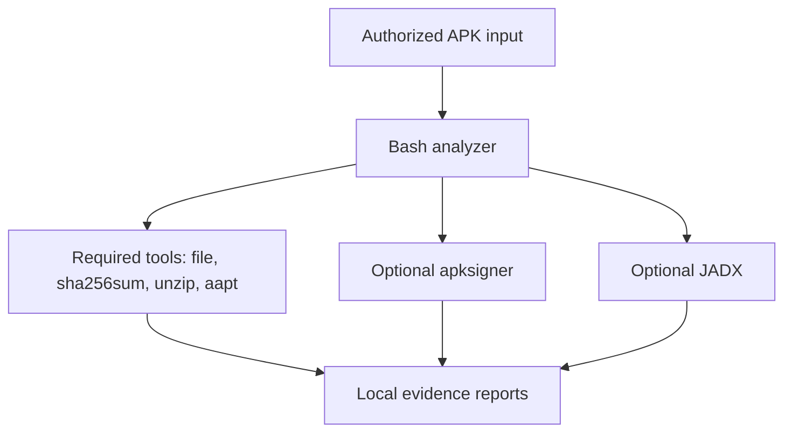

# Architecture

SYJ-RE-Workstation is a Bash orchestration layer around established Android and Linux inspection utilities.

1. **Termux host:** obtains authorized APK inputs and launches Debian PRoot.
2. **Debian PRoot:** provides a Linux userspace and analysis dependencies. It does not change the Android device CPU architecture or provide a full virtual machine.
3. **Static analyzer:** records APK file information, SHA-256, package metadata, permissions, manifest tree and archive inventory. Signature verification and JADX output are conditional on optional tools being installed.
4. **Local evidence directory:** stores per-APK reports outside the public Git repository.

## Data flow

## Design principles

- Preserve original APKs; analyze copies or read-only inputs.
- Keep generated reports out of source control by default.
- Treat tool output as evidence, not a final security conclusion.
- Allow optional tools to be absent without discarding independent results.
- Never execute an APK as part of this static-analysis workflow.
- Keep the Termux host, PRoot userspace and Android device security boundaries distinct.
